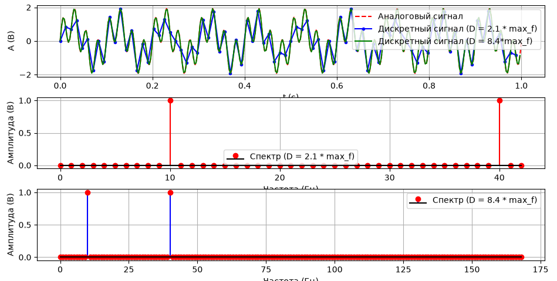
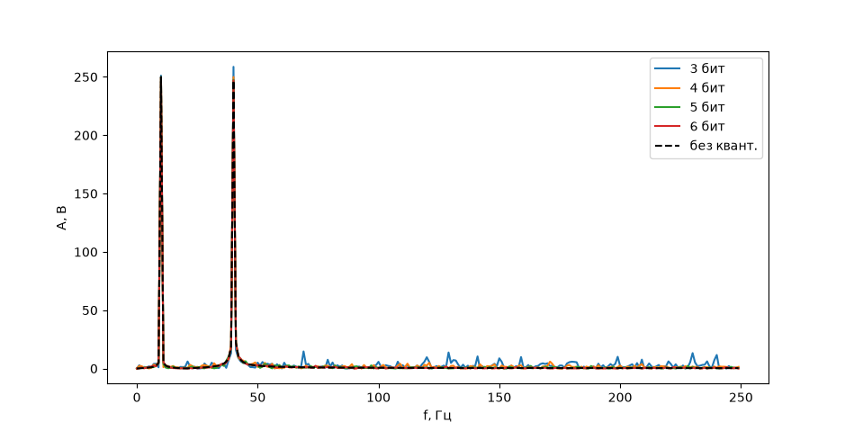
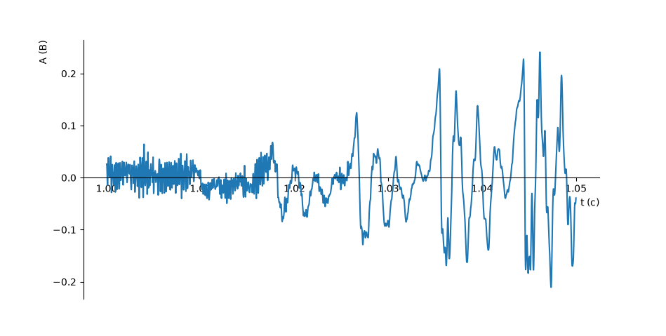

# OSMS

Учебные работы по цифровой обработке сигналов на Python: дискретизация, квантование и анализ аудио.

## Структура

```text
.
├── data/
│   └── audio/                 # исходная WAV-запись и проект Audacity
├── labs/                      # скрипты лабораторных и экспериментов
├── outputs/
│   ├── audio/                 # обработанные аудиофайлы
│   └── figures/               # графики лабораторных
├── requirements.txt
└── README.md
```

## Работы

| Скрипт | Описание |
| --- | --- |
| [`labs/lab01_sampling_quantization.py`](labs/lab01_sampling_quantization.py) | Дискретизация гармонического сигнала, спектры и квантование |
| [`labs/lab02_audio_analysis.py`](labs/lab02_audio_analysis.py) | Временной фрагмент, спектры WAV-аудио и прореживание |
| [`labs/audio_generation.py`](labs/audio_generation.py) | Генерация и воспроизведение музыкального фрагмента |
| [`labs/audio_offset.py`](labs/audio_offset.py) | Пример обработки WAV с добавлением постоянного смещения |

Графики доступны в [`outputs/figures/`](outputs/figures/). Исходная запись для аудио-скриптов находится в `data/audio/input.wav`.

## Запуск

Требуется Python 3. Установите зависимости:

```bash
python -m pip install -r requirements.txt
```

Запускайте скрипты из корня репозитория:

```bash
python labs/lab01_sampling_quantization.py
python labs/lab02_audio_analysis.py
python labs/audio_generation.py
python labs/audio_offset.py
```

Графические скрипты открывают окна Matplotlib. Скрипты воспроизведения требуют доступного аудиоустройства; для `sounddevice` может понадобиться системная библиотека PortAudio. `audio_offset.py` сохраняет результат в `outputs/audio/offset.wav`.

## Примеры

**Дискретизация и спектры**



**Квантование**



**Фрагмент аудиосигнала**


